# Invest: архитектура песочницы стратегий

Проект архитектуры MVP для Т-Инвестиции Premarket, задача 11. Здесь находятся диаграммы и технические решения для обсуждения разработки. Приложение пока не реализовано.

Человек или торговый робот собирает виртуальный портфель и проверяет стратегию на выбранном сценарии рынка. Наш AI-агент готовит сценарий до запуска и разбирает результат после завершения. Во время симуляции решения принимает участник, а деньги и исполнение заявок считает движок.

## Диаграммы

| Уровень | Что показывает | Диаграмма | Исходник |
| --- | --- | --- | --- |
| C4 Context | Граница продукта и внешние участники | [SVG](docs/architecture/rendered/01-context.svg) | [Mermaid](docs/architecture/diagrams/01-context.mmd) |
| C4 Container | Приложения, база данных и протоколы | [SVG](docs/architecture/rendered/02-containers.svg) | [Mermaid](docs/architecture/diagrams/02-containers.mmd) |
| Backend components | Модули одного backend и их зависимости | [SVG](docs/architecture/rendered/03-backend-components.svg) | [Mermaid](docs/architecture/diagrams/03-backend-components.mmd) |
| Sequence: подготовка | Цикл LLM, вызовы инструментов и RAG | [SVG](docs/architecture/rendered/04-prepare-scenario.svg) | [Mermaid](docs/architecture/diagrams/04-prepare-scenario.mmd) |
| Sequence: симуляция | Команды, виртуальное время и транзакция | [SVG](docs/architecture/rendered/05-run-simulation.svg) | [Mermaid](docs/architecture/diagrams/05-run-simulation.mmd) |
| Sequence: разбор | Готовые метрики, журнал и AI-объяснение | [SVG](docs/architecture/rendered/06-review-results.svg) | [Mermaid](docs/architecture/diagrams/06-review-results.mmd) |
| ERD | Сущности PostgreSQL и связи | [SVG](docs/architecture/rendered/07-data-model.svg) | [Mermaid](docs/architecture/diagrams/07-data-model.mmd) |

## Технические решения

- [Границы модулей, агентные инструменты и правила симуляции](docs/architecture/architecture.md).
- [Контракты API и данных](docs/architecture/contracts.md).
- [Модель данных и ограничения](docs/architecture/data-model.md).
- [Как изменять и проверять диаграммы](docs/architecture/README.md).

Стек: Kotlin, Spring Boot, Angular, TypeScript, PostgreSQL, OpenAPI, T-Invest MCP и LLM API. Backend остаётся одним приложением. Для RAG в MVP используем фильтры и полнотекстовый поиск PostgreSQL; отдельная векторная база не требуется выбранному варианту.

## Бизнес-сценарий

Сохранена ранее добавленная командой схема проверки стратегии на исторических данных: [PlantUML](docs/diagrams/business-case.puml), [SVG](docs/diagrams/business-case.svg).

Пользователь выбирает кейс или описывает ситуацию помощнику. Система поэтапно раскрывает данные, человек или робот принимает решения, затем получает журнал и разбор. Техническая граница MVP: T-Invest MCP поставляет рыночные данные; команды в наш симулятор идут через общий API. Подключение существующего робота без изменения его MCP-инструментов потребует отдельного адаптера. Бизнес-схема сохранена как исходная постановка.

## Концептуальные схемы

- [Первоначальная схема компонентов из FigJam](docs/architecture/sandbox-architecture.png).
- [Первоначальная схема этапов и метрик](docs/architecture/sandbox-lifecycle.png).
- [Редактируемая доска FigJam](https://www.figma.com/board/udNCfmxlbHqwijvXoh01XK).
