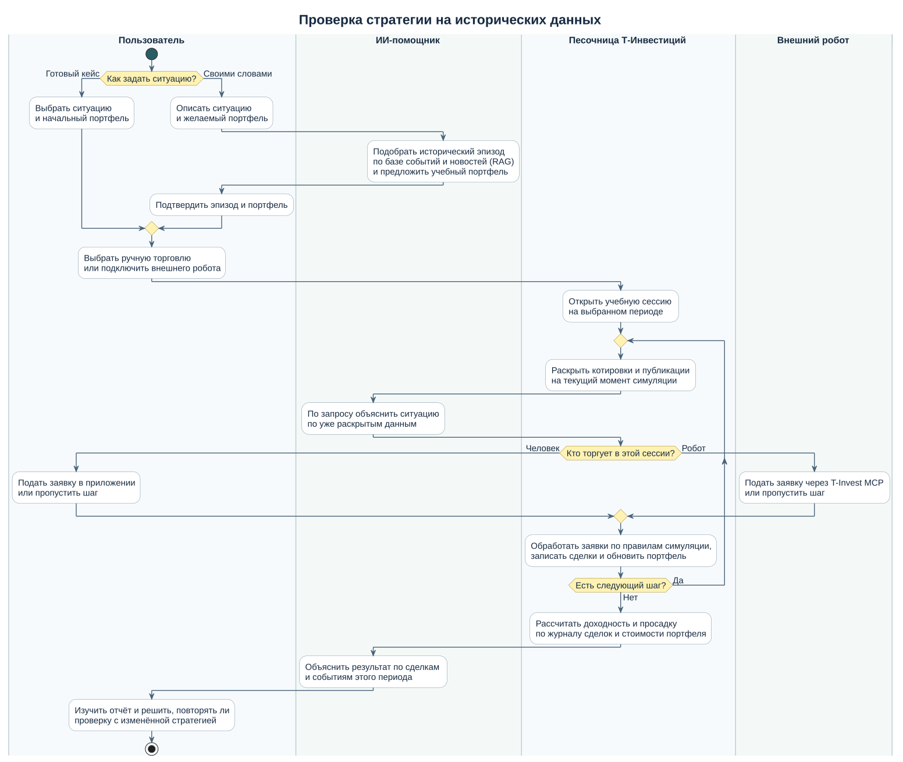

# Invest: песочница инвестиционных стратегий

Материалы команды для соревнования [Т-Инвестиции Premarket](https://meetup.tbank-online.com/invest.premarket).

Пользователь собирает виртуальный портфель и проверяет свою стратегию в разных условиях рынка. С песочницей может работать и человек, и торговый робот через общий API. После симуляции AI разбирает результат и помогает понять, что стоит изменить и проверить ещё раз.

В репозитории опубликованы схема бизнес-процесса и проект архитектуры MVP. Код приложения будет добавлен по мере разработки.

## Основные материалы

- [Архитектура для задачи 11](outputs/01a18d85-14f7-7dd0-874f-31feb3721cf0/architecture/sandbox-architecture.png).
- [Порядок работы симуляции и автоматические метрики](outputs/01a18d85-14f7-7dd0-874f-31feb3721cf0/architecture/sandbox-lifecycle.png).
- [Редактируемая схема в FigJam](https://www.figma.com/board/udNCfmxlbHqwijvXoh01XK).

Команда также подготовила две рабочие таблицы отдельно от репозитория. В первой собраны темы и аналоги, включая лист «03 Песочница стратегий». Во второй — решения других соревнований и варианты применения MCP.

## Проверка стратегии на исторических данных

Пользователь выбирает готовый кейс или описывает ситуацию ИИ-помощнику. Песочница поэтапно раскрывает котировки и новости выбранного периода. Торгует сам пользователь или внешний робот через T-Invest MCP. В конце пользователь получает журнал сделок и разбор результата.

[Исходник схемы в PlantUML](docs/diagrams/business-case.puml) · [Открыть схему в SVG](docs/diagrams/business-case.svg)

## Архитектура MVP

Стек: Kotlin, Spring Boot, Angular, TypeScript, PostgreSQL, OpenAPI, T-Invest MCP и LLM API.

Один backend содержит общий API, AI-Agent, RAG по рыночным событиям, движок симуляции, загрузку данных и расчёт метрик. RAG ищет события и связанную историю в PostgreSQL. AI-Agent и LLM готовят учебный сценарий до старта и разбирают результат после завершения. Во время прогона человек или робот действует самостоятельно.

Движок считает виртуальные деньги, заявки, стопы, комиссии и просадку. Исторические данные и искусственные учебные цены хранятся отдельно. Для повторных проверок фиксируем сценарий и версию данных.

Обе схемы выгружены из [доски FigJam](https://www.figma.com/board/udNCfmxlbHqwijvXoh01XK). Нажмите на изображение, чтобы открыть его в полном размере.

### Компоненты и интеграции

### Этапы симуляции и метрики

